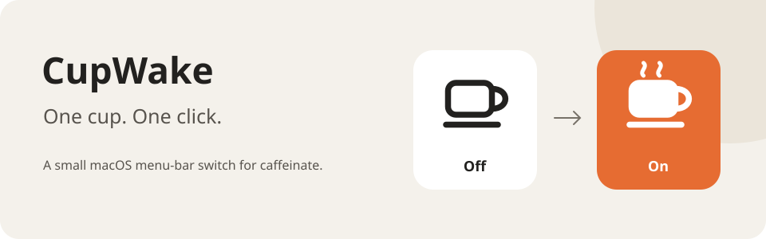

# CupWake

**Keep your Mac awake. One click.**



A small native macOS app that puts `caffeinate` in your menu bar.
Click to turn it on. Click again to turn it off. That is the whole app.

[**Download the preview →**](https://github.com/nickdrezza/CupWake/releases/tag/v0.2.0)

## One cup. Two states.

- **Empty cup:** Off.
- **Full cup with steam:** On. The Mac stays awake during idle time.
- **Right-click:** Quit CupWake. Control-click works too.

CupWake starts Off. It has no window, settings, timer, or saved state.
It uses three small Swift source files and no package dependencies.

> **Do not use CupWake while your Mac is in a backpack or an enclosed space.**
> Keep the Mac on an open surface with airflow. CupWake does not monitor heat or battery charge.

## Install

The preview download is for **Apple silicon** Macs with macOS 13 or later.
Unzip the file, move `CupWake.app` to Applications, and open it.

This preview has a local ad hoc signature. It has no Developer ID signature or notarization.
macOS can block a downloaded copy. You can build from source instead.
See [Apple's distribution guide](https://developer.apple.com/developer-id/) for the signing requirements.

## What On does

CupWake runs `/usr/bin/caffeinate -w <CupWake PID>` with no assertion flags.
This uses the default `caffeinate` behavior: prevent idle system sleep.
The display can still sleep. CupWake does not change lid-close behavior or power settings.

Off and Quit stop only the child that CupWake started. The `-w` option makes the child exit
if CupWake exits, including after a crash. If the child exits, the icon returns to Off.
If startup fails, the icon stays Off and the app sounds a beep.
Other apps can still prevent sleep after CupWake turns Off.

See `man caffeinate` on your Mac for the command reference.

## Build from source

Use Swift 6 or later on macOS 13 or later. Tests require macOS 14 or later.

```sh
git clone https://github.com/nickdrezza/CupWake.git
cd CupWake
sh Scripts/test.sh
sh Scripts/build-app.sh
open dist/CupWake.app
```

Tests briefly run real `caffeinate` processes. Run them with the Mac on an open surface.
The build script creates a locally signed app with Hardened Runtime in `dist/`.
It does not install the app or change system settings. Do not build as root.

To create a release archive and SHA-256 checksum:

```sh
sh Scripts/package-release.sh
```

## Inside the cup

| File | Purpose |
| --- | --- |
| `CupWakeApp.swift` | Menu-bar item, click actions, and Quit. |
| `CaffeinateController.swift` | One owned child process and exit cleanup. |
| `CupIcon.swift` | Empty and full vector cup icons. |

No background timer, network request, power monitor, or privileged helper is used.
Stopping the child does not block the main thread. Old exit callbacks cannot clear a new child.
Tests cover process ownership, shutdown, startup errors, and both icons at 1× and 2×.
See [BUILD_STATUS.md](BUILD_STATUS.md) for the checks and limits of this build.

## License

Copyright 2026 Nick. [GPL-3.0-only](LICENSE).
